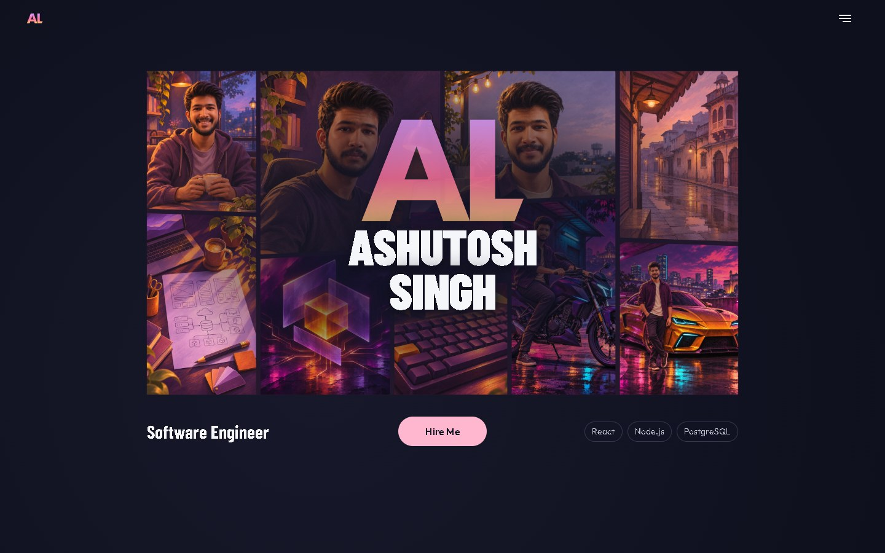
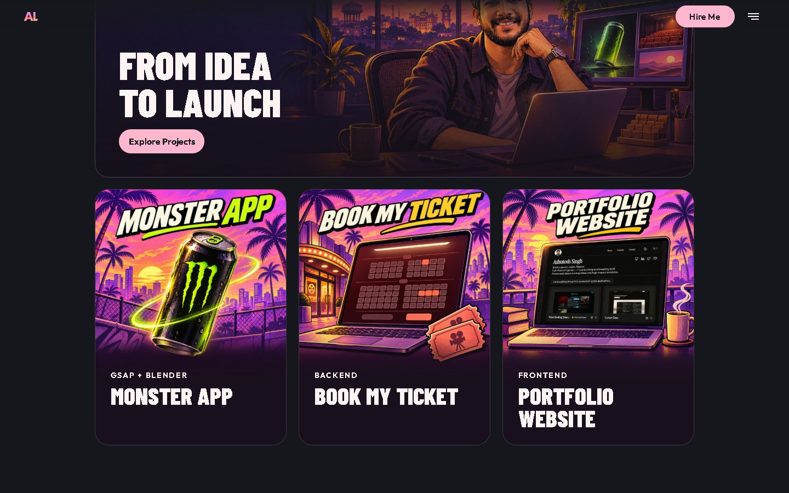
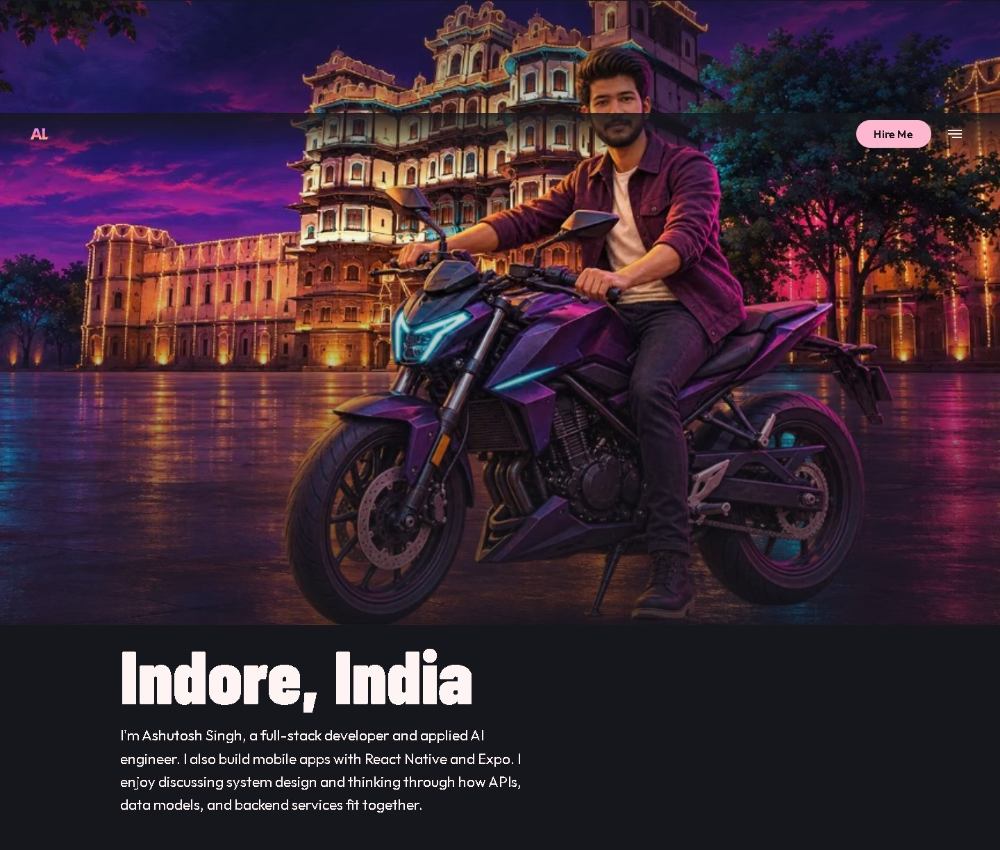
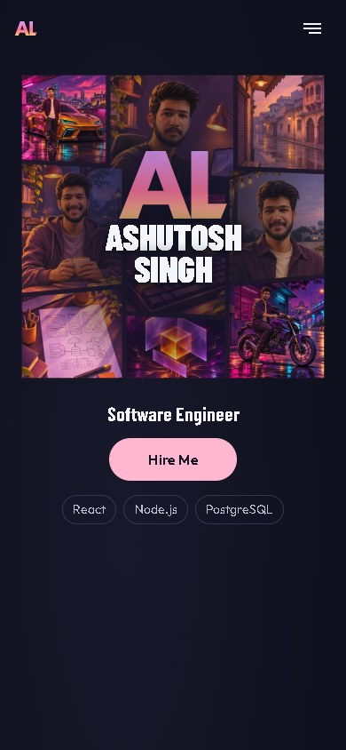

# AshuLabs | Grand Theft Developer

A full-stack developer portfolio set against sunset streets, neon signs, and the skyline of Indore. Inspired by the art direction of GTA VI, with custom illustrations and scroll-driven scenes.

## Selected Work

Three projects with their own illustrated covers. Monster App explores 3D motion with GSAP and Blender, Book My Ticket showcases backend work, and Portfolio Website focuses on the frontend.

## Indore After Dark

The city scene pulls back from a motorcycle on wet streets to reveal Rajwada Palace as you scroll.

## On Mobile

Portrait artwork reframes the opening shot, and project cards can be swiped on smaller screens.

## Run Locally

Built with React, Vite, Tailwind CSS, and GSAP ScrollTrigger.

~~~bash
bun install
bun run dev
~~~

Use `bun run build` for a production build and `bun run lint` to check the source.

## Content and Integrations

- Edit [`src/content.js`](src/content.js) for copy, project links, and contact settings. [`CONTENT.md`](CONTENT.md) documents the page sections.
- Hire Me submits inquiries through FormSubmit and shows the result in the footer. Book a Call opens the Cal.com scheduler in the same panel.
- The blog pulls recent posts from Hashnode and uses bundled posts if the feed is unavailable.

Independent portfolio project. No affiliation with Rockstar Games.
